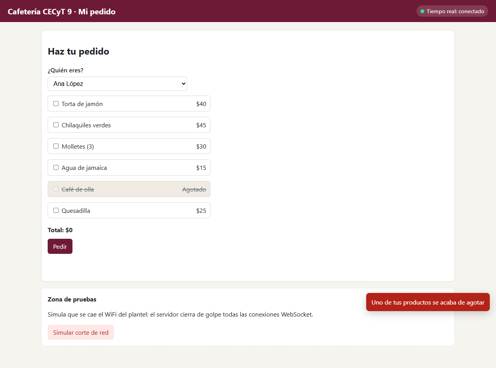
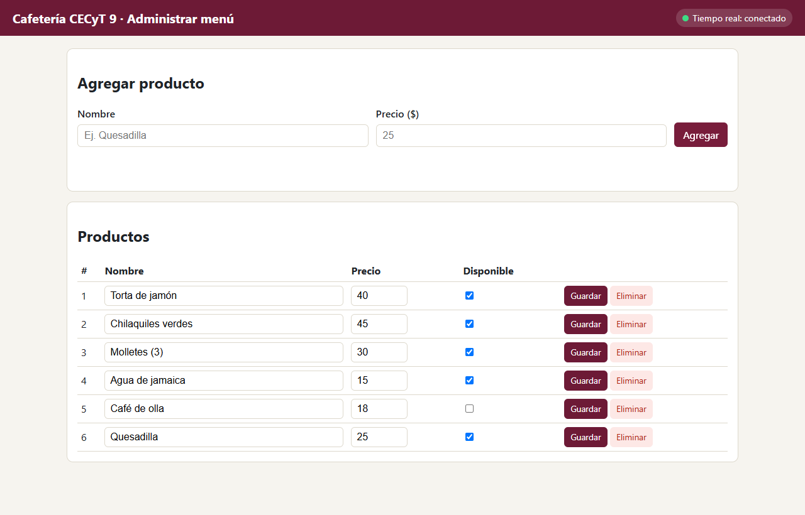

# Sesión 1 — La cafetería en tiempo real: CRUD con MySQL + menú en vivo

**Introducción a los Sistemas Distribuidos · Parcial 3 · semana 12 (9 al 13 de noviembre) · trabajo individual**

La cafetería del plantel quiere un sistema de pedidos. El menú, los usuarios y los pedidos se guardan en **MySQL**, y las
pantallas se avisan entre sí en tiempo real:

| Pantalla | Quién la usa | Qué hace |
|---|---|---|
| `productos.html` | Quien administra el menú | Agrega, edita, marca como agotados y borra productos |
| `cliente.html` | El alumno | Elige su nombre, arma su pedido con el menú y lo sigue |
| `cocina.html` | La cocina | Ve los pedidos que llegan y los avanza de estado |

Hoy construyes el **CRUD de productos** (la API REST con MySQL) y haces que el menú del alumno cambie **solo**, sin
recargar, cuando alguien lo modifica. Así se verá el alumno al terminar: el café se agotó y se tachó al instante.



## Lo que vas a aprender

Este ejercicio es **complementario**: **no toca el proyecto CECyT9**. Practicas WebSocket en un escenario aparte, y el
mismo patrón lo aplicas al proyecto CECyT9 en la integradora de la semana 13. Al terminar sabrás:

1. Escribir un **CRUD** (crear, leer, actualizar, borrar) con Express y MySQL usando consultas con `?`.
2. Distinguir **para qué sirve la API REST** (hacer cosas y guardarlas) y **para qué sirve el WebSocket** (que el servidor avise sin que le pregunten).
3. Montar un servidor WebSocket sobre el **mismo puerto** que Express y hacer **difusión**: un mensaje que les llega a todas las pantallas a la vez.

## Cómo organizar tu tiempo

| Cuándo | Pasos | Tiempo aproximado |
|---|---|---|
| Aula (1 h), antes del laboratorio | 0 y 1: dejar MySQL, `.env` y el servidor funcionando | 35 a 45 min |
| Laboratorio (2 h) | 2 a 5 | 90 a 120 min |
| Fuera de clase | 6 (pruebas, capturas y preguntas) y lo que no alcances | 30 min |

Si vas adelantado, sigue con el siguiente paso. Si te atrasas, **no te saltes pasos**: cada uno usa lo del anterior.

**Cómo usar esta guía**

- Donde diga **Tu turno**, la guía no te da el código completo: lo escribes tú con la pista. En el código lo encuentras con el mismo comentario `// Tu turno (sesión 1, paso N)`.
- Al final de cada paso hay una lista **Comprueba**. No pases al siguiente hasta que todo esté marcado.
- Hay comentarios `// Tu turno (sesión 2, ...)`: **no los toques hoy**, son de la siguiente sesión.
- Si algo falla, revisa [Problemas comunes](#problemas-comunes).

---

## Paso 0 — Preparar el material (20 min)

Necesitas **Node.js 18 o más nuevo** (`node -v`) y **MySQL 8 encendido** (el mismo del Parcial 2; también funciona con
MariaDB/XAMPP). El ejercicio vive en
`parcial-3-jwt-dashboard-websockets/ejercicio-websocket-cafeteria/base/` de tu repositorio de Distribuidos.

1. Abre una terminal **en la carpeta `base`** e instala las dependencias (Express, `ws`, `mysql2` y `dotenv`):

   ```bash
   cd parcial-3-jwt-dashboard-websockets/ejercicio-websocket-cafeteria/base
   npm install
   ```

2. Copia `.env.example` con el nombre `.env` y escribe **tu** contraseña de MySQL en `DB_PASSWORD`.
   En la terminal: `copy .env.example .env` (PowerShell o CMD) o `cp .env.example .env` (Git Bash). También puedes
   copiar y pegar el archivo en VS Code y renombrarlo. El archivo `.env` no se sube a Git (ya está en `.gitignore`).

3. Carga la base de datos que te entregamos. Ya trae sus tablas y datos de ejemplo: 4 tablas, `usuarios` (4 alumnos y
   la cocina), `productos` (5 productos), `pedidos` y `pedido_productos`. Tú **no** diseñas la base: solo la cargas.
   Elige **una** de estas dos formas:

   - **Opción A — MySQL Workbench:** *File → Open SQL Script…* → elige `base/bd/cafeteria.sql` → pulsa el botón del
     rayo (*Execute*). Al refrescar el panel *Schemas* aparece la base `cafeteria`.
   - **Opción B — terminal:**

     ```bash
     npm run bd
     ```

     Debe decir `Base de datos "cafeteria" creada con datos de ejemplo.`.

   **Ojo:** las dos formas borran la base y la vuelven a crear; úsalas también cuando quieras empezar con datos limpios.
   Si en tu `.env` cambiaste `DB_NAME`, usa la opción B (el `.sql` usa el nombre `cafeteria`). La base ya trae todo lo
   que vas a necesitar en las dos sesiones: en la sesión 2 **no** se vuelve a cargar ni se le agrega nada.

4. Arranca el servidor:

   ```bash
   npm start
   ```

   ```text
   Cafetería lista en http://localhost:4500
     Alumno: http://localhost:4500/cliente.html
     Cocina: http://localhost:4500/cocina.html
     Menú:   http://localhost:4500/productos.html
   ```

5. Conoce los archivos. Los que tienen ✏️ los modificas hoy:

   | Archivo | Qué es |
   |---|---|
   | `server.js` | Arranca Express y el WebSocket **en el mismo puerto** |
   | `db.js` | La conexión a MySQL (lee tu `.env`) |
   | `bd/cafeteria.sql` | La base de datos **completa** (tablas y datos de ejemplo) para las dos sesiones. No la modificas |
   | `bd/crear-bd.js` | Carga `cafeteria.sql` desde Node (`npm run bd`; también lo usan las pruebas) |
   | `modelos/usuarios.modelo.js`, `modelos/pedidos.modelo.js` | Usuarios y pedidos: **ya vienen hechos** |
   | ✏️ `modelos/productos.modelo.js` | Las consultas SQL de productos |
   | ✏️ `rutas/productos.rutas.js` | La API REST de productos |
   | `rutas/usuarios.rutas.js`, `rutas/pedidos.rutas.js` | API de usuarios y pedidos (ya hecha) |
   | ✏️ `tiempo-real.js` | El servidor WebSocket |
   | `public/*.html`, `public/js/productos.js`, `public/js/cocina.js` | Las pantallas (ya hechas) |
   | ✏️ `public/js/cliente.js` | La pantalla del alumno |
   | `pruebas/probar.js` | Pruebas automáticas (`npm run probar:s1`) |

> **Importante:** el servidor no se reinicia solo. Cada vez que cambies un archivo del servidor (`modelos/`, `rutas/`,
> `tiempo-real.js`), detenlo con **Ctrl+C** y vuelve a correr `npm start`. Si cambias un archivo de `public/`, basta
> con recargar la página con **Ctrl+F5**. Los datos **no** se pierden al reiniciar: están en MySQL.

**Comprueba**

- [ ] La base `cafeteria` existe (Workbench o `npm run bd`) y `npm start` funciona sin errores.
- [ ] `http://localhost:4500` abre la página de inicio con tres opciones.

---

## Paso 1 — Conocer lo que ya funciona (15 min)

La API REST es **por donde se hacen las cosas**. Estas rutas ya funcionan:

| Método y ruta | Para qué |
|---|---|
| `GET /api/usuarios?rol=alumno` | La lista de alumnos (para "¿Quién eres?") |
| `GET /api/productos` y `GET /api/productos/:id` | Ver el menú o un producto |
| `POST /api/pedidos` | Hacer un pedido: `{ "usuarioId": 1, "productos": [1, 4] }` |
| `GET /api/pedidos` | La cocina ve todos los pedidos |
| `PATCH /api/pedidos/:id/estado` | La cocina cambia el estado: `{ "estado": "preparando" }` |

1. Abre `cliente.html`, elige a **Ana López**, marca dos productos y pide. Tu pedido queda en **Recibido** y no avanza
   en pantalla aunque la cocina lo mueva: eso lo haces en la sesión 2.
2. Abre `productos.html`. Intenta agregar un producto: sale `Ruta no encontrada`, porque el `POST` todavía no existe.
   Es lo esperado.
3. Opcional: en MySQL Workbench, `SELECT * FROM cafeteria.pedidos;` muestra el pedido que acabas de hacer.

**Comprueba**

- [ ] Tu pedido se guardó: aparece en `cocina.html` (con F5).
- [ ] En `productos.html` se ven los 5 productos, pero no puedes agregar ni editar.

---

## Paso 2 — El modelo: las consultas SQL (20 min)

Abre `modelos/productos.modelo.js`. `listar()` y `obtener(id)` ya vienen hechas: léelas, son tu ejemplo.

- `pool.query(sql, valores)` regresa un arreglo; el primer elemento es el resultado. Por eso se escribe `const [filas] = await pool.query(...)`.
- Cada `?` del SQL se reemplaza, en orden, por un valor del arreglo. **Nunca** pegues valores dentro del texto del SQL: los `?` evitan la **inyección SQL**.
- MySQL guarda `disponible` como `1` o `0`. Para guardar: `disponible ? 1 : 0`. Para leer, `aProducto()` lo convierte en `true` o `false`.

**Tu turno** (`modelos/productos.modelo.js`):

1. `crear({ nombre, precio, disponible })`: un `INSERT INTO productos (nombre, precio, disponible) VALUES (?, ?, ?)`.
   El resultado trae `insertId`, el id que MySQL le dio. Regresa `obtener(resultado.insertId)`.
2. `actualizar(id, { nombre, precio, disponible })`: un `UPDATE productos SET nombre = ?, precio = ?, disponible = ? WHERE id = ?`.
   Regresa `obtener(id)`.
3. `eliminar(id)`: un `DELETE FROM productos WHERE id = ?`. El resultado trae `affectedRows`, cuántas filas borró.
   Regresa `resultado.affectedRows > 0`.

Todavía no puedes probarlo: falta la ruta (paso 3).

---

## Paso 3 — La API: POST, PUT y DELETE (25 min)

Abre `rutas/productos.rutas.js`. Ya vienen hechos:

- `validar(datos)`: regresa un mensaje de error, o `null` si el nombre y el precio están bien.
- `avisarMenu()`: la usarás en el paso 4. **Hoy no la llames todavía.**
- Las dos rutas `GET`. Fíjate en `envolver(async (req, res) => { ... })`: atrapa los errores de MySQL y responde `500`
  en JSON en lugar de dejar la petición colgada. Úsalo en todas tus rutas.

**Tu turno** (`rutas/productos.rutas.js`). El `POST` va completo como ejemplo. Escríbelo y entiende cada línea:

```js
router.post('/', envolver(async (req, res) => {
  const error = validar(req.body || {});
  if (error) return res.status(400).json({ error });

  const { nombre, precio, disponible } = req.body;
  const producto = await productos.crear({ nombre: nombre.trim(), precio, disponible });
  res.status(201).json(producto);
}));
```

Ahora escribe tú los otros dos:

- **`PUT /:id`**: busca el producto con `productos.obtener(req.params.id)`. Si no existe, responde `404` con
  `{ error: 'Producto no encontrado' }`. Si existe, valida igual que en el POST (`400`), llama a
  `productos.actualizar(existente.id, {...})` y responde `200` con el producto actualizado. Pista: si el cuerpo no trae
  `disponible`, conserva el que tenía (`const { nombre, precio, disponible = existente.disponible } = req.body;`).
- **`DELETE /:id`**: llama a `productos.eliminar(req.params.id)`. Si regresó `false`, responde `404` con el mismo
  mensaje. Si borró, responde `204` sin cuerpo: `res.status(204).end()`.

Reinicia el servidor y prueba con **Postman** (o con `productos.html`, que ya usa estas rutas). En una base recién
creada con `npm run bd`, el primer producto nuevo recibe el id **6**. Si ya habías agregado otros, usa el `id` que te
regresó **tu** POST: MySQL no reutiliza los id borrados.

| Petición | Cuerpo (raw → JSON) | Esperado |
|---|---|---|
| `POST /api/productos` | `{ "nombre": "Quesadilla", "precio": 25 }` | `201` y el producto con su `id` |
| `POST /api/productos` | `{ "nombre": "Gratis", "precio": 0 }` | `400` |
| `PUT /api/productos/ID` | `{ "nombre": "Quesadilla", "precio": 28, "disponible": false }` | `200` |
| `DELETE /api/productos/ID` | — | `204` |
| `DELETE /api/productos/ID` (otra vez) | — | `404` `Producto no encontrado` |

**Comprueba**

- [ ] Las 5 peticiones de la tabla dan lo esperado.
- [ ] En `productos.html` ya puedes agregar, editar, marcar como agotado y eliminar.
- [ ] Reinicias el servidor y los cambios **siguen ahí** (están en MySQL).

---

## Paso 4 — El problema y la difusión por WebSocket (25 min)

Pon dos ventanas lado a lado: `productos.html` a la izquierda y `cliente.html` a la derecha.

1. En **productos**, desmarca **Disponible** del *Café de olla*. Fíjate en el **cliente**: sigue mostrando el café
   como si nada. Tendría que recargar (F5) para enterarse.
2. En el cliente, marca el café y pide. La API responde **409** `"Café de olla" ya no está disponible`. El servidor
   protegió los datos, pero el alumno perdió su tiempo armando un pedido imposible.

La API REST es **petición-respuesta**: el servidor **nunca** habla si nadie le pregunta. Para que el menú cambie solo,
el servidor tiene que poder **avisar**. Para eso sirve un **WebSocket**: una conexión que se queda abierta en los dos
sentidos. Arranca como una petición HTTP normal (por eso usa el mismo puerto 4500) y luego "se actualiza" a WebSocket.

Abre `tiempo-real.js` y lee el comentario de arriba: ahí está el **protocolo**, es decir, qué mensajes existen. Todos
son objetos JSON con un campo `tipo`. Hay **tres alcances** de aviso: a **todos**, a un **grupo** y a **uno**.
Hoy haces el primero. Fíjate en lo que ya viene hecho:

- `new WebSocketServer({ server: servidorHttp, path: '/tiempo-real' })`: el WebSocket se cuelga del mismo servidor HTTP.
- `enviar(socket, mensaje)` convierte el objeto a texto con `JSON.stringify` y lo manda solo si el socket sigue abierto.
- `wss.clients` es el conjunto de **todos** los sockets conectados en este momento.

**Tu turno** (`tiempo-real.js`): en `difundirATodos(mensaje)`, recorre `wss.clients` con `for (const socket of wss.clients)`
y a cada uno mándale el mensaje con `enviar`.

**Tu turno** (`rutas/productos.rutas.js`): en `POST`, `PUT` y `DELETE`, justo **después** de que el cambio se guardó
y **antes** de responder, agrega `await avisarMenu();`. Esa función ya hecha lee el menú completo de MySQL y lo difunde
como `{ tipo: 'menu_actualizado', productos: [...] }`.

Reinicia el servidor y **pruébalo a mano**, sin la página del alumno. En cualquier pestaña de `http://localhost:4500`,
abre la consola (**F12 → Consola**) y escribe:

```js
const ws = new WebSocket('ws://localhost:4500/tiempo-real');
ws.onmessage = (e) => console.log('Llegó:', JSON.parse(e.data));
```

> Chrome nuevo no deja **pegar** código en la consola: si sale un aviso, escribe `allow pasting`, Enter, y vuelve a pegar.

Ahora agrega un producto desde Postman o desde `productos.html` y mira la consola: llega `menu_actualizado` con el menú
completo **sin que la consola haya preguntado nada**.

**Comprueba**

- [ ] En la consola llega `menu_actualizado` al hacer POST, PUT y DELETE.
- [ ] Si abres `productos.html` en **dos** pestañas, lo que cambias en una aparece en la otra. Esa página ya sabía escuchar el mensaje; solo le faltaba que el servidor lo mandara.

---

## Paso 5 — El menú del alumno se actualiza solo (10 min)

`cliente.js` ya abre el WebSocket al cargar la página y manda cada mensaje a `manejarMensaje(mensaje)`. Pero esa función
todavía ignora el menú.

**Tu turno** (`public/js/cliente.js`): en `manejarMensaje`, si `mensaje.tipo === 'menu_actualizado'`, llama a
`pintarMenu(mensaje.productos)`. `pintarMenu` ya viene hecha: conserva lo que el alumno tenía marcado, tacha lo
agotado y, si se agota algo que tenías marcado, lo desmarca y te avisa.

Recarga con **Ctrl+F5**. Abre `productos.html` y **dos** pestañas de `cliente.html`.

**Comprueba**

- [ ] Agregas un producto y aparece en los dos clientes sin recargar.
- [ ] Cambias un precio y el cliente muestra el precio nuevo (y el total se recalcula).
- [ ] Marcas el café en un cliente, lo agotas en productos: el café se tacha, se desmarca y sale el aviso
      **Uno de tus productos se acaba de agotar**.

Esto es **difusión**: un solo cambio en el servidor, el mismo mensaje a **todas** las pantallas conectadas. Es la misma
idea que la multidifusión del servidor de sockets TCP del Parcial 2, pero ahora en el navegador.



---

## Paso 6 — Pruebas automáticas y entrega (15 min)

```bash
npm run probar:s1
```

Las pruebas **no tocan** tu base `cafeteria`: crean su propia base `cafeteria_pruebas` desde cero y arrancan su propio
servidor en el puerto 4599. Debe terminar con `11 de 11 pruebas pasaron.` Si alguna sale con ✘, su nombre te dice qué revisar.

**Entrega** (en el formato que pida tu docente):

1. Captura con `productos.html` y **dos** `cliente.html` visibles, con un producto agotado tachado en los dos clientes.
2. Captura de la terminal con `11 de 11 pruebas pasaron.`
3. Respuestas:
   1. El servidor manda el **menú completo** cada vez, no solo el producto que cambió. ¿Qué ventaja tiene si un aviso se pierde? ¿Qué pasaría con el tamaño de cada aviso si el menú tuviera 500 productos?
   2. La API ya rechaza con `409` un pedido con un producto agotado. Entonces, ¿para qué sirve el WebSocket? ¿Podríamos quitar esa validación del servidor ahora que el menú se actualiza solo? ¿Por qué?
   3. Al reiniciar el servidor los productos siguen ahí, pero las conexiones WebSocket se cortan. ¿Por qué las conexiones **no** se guardan en MySQL? Pista: una conexión es un canal abierto entre dos programas que están corriendo; ¿qué queda de ese canal cuando uno de los dos se detiene?

---

## Problemas comunes

| Síntoma | Causa probable | Solución |
|---|---|---|
| `connect ECONNREFUSED ...:3306` | MySQL está apagado | Enciéndelo: Servicios de Windows → **MySQL80** → Iniciar |
| `Access denied for user 'root'` | La contraseña de tu `.env` está mal | Corrige `DB_PASSWORD` en `.env` |
| `Unknown database 'cafeteria'` | No cargaste la base | Paso 0.3: importa `bd/cafeteria.sql` en Workbench o corre `npm run bd` |
| En Workbench los nombres salen como `López` | El script se abrió con otra codificación | Vuelve a abrir `cafeteria.sql` con *File → Open SQL Script…* (no copies y pegues desde otro editor) y ejecútalo otra vez; o usa `npm run bd` |
| La API responde `Error del servidor (¿MySQL está encendido?)` | MySQL apagado o error en tu SQL | Mira la terminal del servidor: ahí sale el error real de MySQL |
| `Error: listen EADDRINUSE :::4500` | Ya tienes otro servidor en ese puerto | Cierra la otra terminal. O cambia `PORT` en `.env` (por ejemplo 4501) y usa ese puerto en tus URLs |
| `Cannot find module 'ws'` (o `mysql2`, `dotenv`) | No corriste `npm install` en `base` | `npm install` dentro de `base` |
| Cambié el servidor y no pasa nada | No se reinicia solo | Ctrl+C y `npm start` |
| Cambié `cliente.js` y no pasa nada | El navegador guardó la versión vieja | Ctrl+F5 |
| Después del paso 3, el `POST` sigue respondiendo `404 Ruta no encontrada` | La ruta no se registró (error al escribir `router.post`) o no reiniciaste | Revisa el paso 3 y reinicia (en el paso 1 ese 404 es normal) |
| `npm run bd` o el `.sql` dicen `Unknown collation` | Tu MySQL es muy viejo | Usa MySQL 8 o MariaDB 10.4 o más nuevo |
| `fetch is not defined` al correr las pruebas | Node muy viejo | Necesitas Node 18 o más nuevo |

## Retos extra (si terminas antes)

1. Agrega un campo **categoría** (comida o bebida) a la tabla y al CRUD, y agrupa el menú del alumno por categoría.
2. En lugar de mandar el menú completo, manda solo el cambio (`producto_creado`, `producto_actualizado`, `producto_eliminado`) y actualiza la lista del cliente con eso. Compara qué tan fácil es equivocarse.
