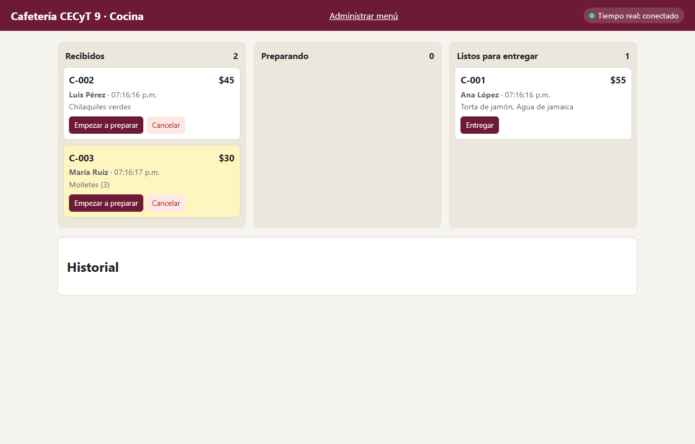
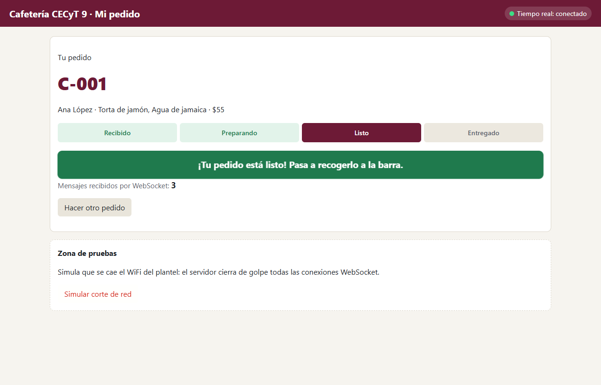
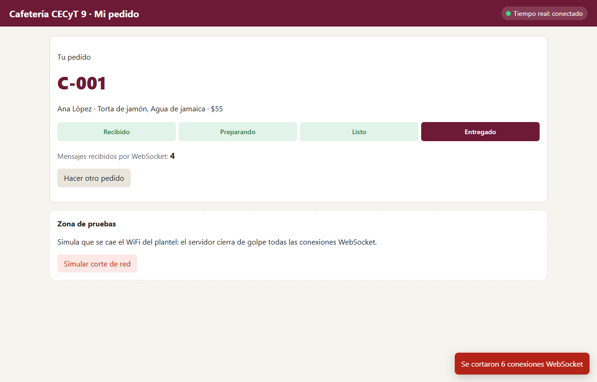

# Sesión 2 — La cafetería en tiempo real: pedidos, mensajes dirigidos y reconexión

**Introducción a los Sistemas Distribuidos · Parcial 3 · semana 13 (16 al 20 de noviembre) · trabajo individual**

En la sesión 1 el **menú** quedó en tiempo real con un aviso **a todos**. Hoy toca los **pedidos**:

- la **cocina** ve llegar los pedidos sin recargar (aviso a un **grupo**);
- el **alumno** ve avanzar **su** pedido, y solo el suyo (aviso a **uno**);
- todo aguanta que se caiga la red o que se reinicie el servidor.

Así se ve la cocina al terminar:



## Lo que vas a aprender

1. Los tres alcances de un aviso en tiempo real: **difusión a todos**, **a un grupo** y **dirigido a uno**, y por qué no basta con mandar todo a todos y filtrar en el navegador.
2. **Suscribirse** a un recurso por WebSocket demostrando que es tuyo (la `clave`).
3. Qué pasa con los mensajes **mientras no hay conexión**, cómo ponerse al día (**resincronizar**) al reconectar, y qué guarda MySQL y qué no.
4. Probar un sistema en tiempo real con **pruebas automáticas**, incluida una que tú escribes.

Este ejercicio es **complementario** a la integradora de esta misma semana 13: ahí aplicas este patrón al proyecto CECyT9.

## Cómo organizar tu tiempo

| Cuándo | Pasos | Tiempo aproximado |
|---|---|---|
| Laboratorio (2 h) | 0 a 5 | 110 a 130 min |
| Aula (1 h) o fuera de clase | 6 y 7 (pruebas, capturas y preguntas) y lo que no alcances | 40 min |

Trabajas sobre **la misma carpeta `base`** de la sesión 1. Hoy buscas los comentarios `// Tu turno (sesión 2, paso N)`.

---

## Paso 0 — Punto de partida (5 min)

La base de datos es **la misma de la sesión 1** y ya trae todo lo que necesitas hoy: **no** la vuelvas a cargar
(`npm run bd` o importar `cafeteria.sql` borraría los productos que agregaste). Enciende MySQL y, en la carpeta `base`:

```bash
npm run probar:s1
npm start
```

**Comprueba**

- [ ] `11 de 11 pruebas pasaron.` Si no, termina primero la sesión 1: hoy todo se construye encima.
- [ ] Los pedidos ya funcionan por la API (los usaste en la sesión 1): `POST /api/pedidos` y `PATCH /api/pedidos/:id/estado`.
      La máquina de estados (`estados.js`) ya viene hecha: un salto como `recibido` → `entregado` responde `409`.

---

## Paso 1 — Aviso a un grupo: la cocina (25 min)

El menú le interesa a **todos**. Los pedidos nuevos solo le interesan a la **cocina**. Por eso la pantalla de cocina,
al conectarse, se presenta con el mensaje `{ "tipo": "soy_cocina" }`, y el servidor guarda su socket en el `Set`
llamado `cocinas`. Mira `public/js/cocina.js` (ya viene hecho): en `socket.onopen` manda `soy_cocina`, y en
`manejarMensaje` atiende `pedido_nuevo` y `pedido_actualizado`.

**Tu turno** (`tiempo-real.js`):

1. Dentro de `socket.on('message', ...)`, si `mensaje.tipo === 'soy_cocina'`: agrega el socket a `cocinas` y contéstale
   `{ tipo: 'bienvenida', rol: 'cocina' }`. Usa `return enviar(...)` para que no siga hasta el mensaje de
   "Tipo de mensaje desconocido".
2. Escribe `avisarCocina(tipo, pedido)`: recorre `cocinas` con `for (const socket of cocinas)` y a cada uno mándale
   `{ tipo, pedido }` con `enviar`. Es igual que `difundirATodos`, pero sobre el grupo y no sobre `wss.clients`.

Al cerrarse un socket, ya viene hecho que se saque de `cocinas` (`socket.on('close')`). Sin eso, el servidor seguiría
intentando avisarle a pantallas que ya no existen.

**Tu turno** (`rutas/pedidos.rutas.js`), donde dice `sesión 2, paso 1`:

3. En el `POST`, después de crear el pedido: `avisarCocina('pedido_nuevo', pedidos.publico(pedido));`
4. En el `PATCH`, después de cambiar el estado: `avisarCocina('pedido_actualizado', actualizado);`

> `pedidos.publico(pedido)` quita la `clave`. Las pantallas de cocina **nunca** deben recibir las claves de los alumnos.

Reinicia el servidor. Abre **dos** pestañas de `cocina.html` y una de `cliente.html`.

**Comprueba**

- [ ] Haces un pedido y aparece **en las dos cocinas** sin recargar (resaltado en amarillo).
- [ ] Pulsas **Empezar a preparar** en una cocina y la tarjeta se mueve también **en la otra**.
- [ ] El cliente no dijo `soy_cocina`, así que **no** recibe `pedido_nuevo`. Lo comprueba la prueba **GRUPO** del paso 6.

> **¿Y si dos cocinas mueven el mismo pedido al mismo tiempo?** Con un solo ratón no puedes pulsar en dos ventanas a
> la vez, así que simúlalo: con un pedido en **Preparando**, en la consola de una cocina manda dos PATCH al mismo tiempo
> (cambia `ID` por el id del pedido):
>
> ```js
> Promise.all([1, 2].map(() => fetch('/api/pedidos/ID/estado', { method: 'PATCH', headers: { 'Content-Type': 'application/json' }, body: '{"estado":"listo"}' }).then((r) => r.status)))
> ```
>
> El resultado es `[200, 409]` (o `[409, 200]`): una gana y la otra recibe
> `Otra pantalla de cocina cambió este pedido al mismo tiempo`. Mira `cambiarEstado` en `modelos/pedidos.modelo.js`:
> el `UPDATE ... WHERE id = ? AND estado = ?` solo cambia el pedido si **sigue** en el estado que se leyó. Así se evita
> que dos nodos pisen el mismo dato.

---

## Paso 2 — Difusión contra mensaje dirigido (10 min)

Imagina que el servidor mandara **cada** cambio de pedido a **todos** los alumnos y que cada página "ignorara" los ajenos:

- Cualquiera con **F12 → Red → WS** vería los pedidos y nombres de todos. Que la página no los muestre no significa que no le lleguen.
- Con 200 alumnos conectados, cada cambio se convierte en 200 mensajes, y casi todos no le sirven a nadie.

Por eso el alumno **se suscribe** solo a su pedido:

```text
Navegador del alumno                          Servidor
        │  {"tipo":"suscribir","pedidoId":3,"clave":"9f2c…"}  │
        │ ───────────────────────────────────────────────────► │  ¿existe el 3? ¿la clave es la suya?
        │  {"tipo":"suscrito","pedido":{… estado actual …}}   │
        │ ◄─────────────────────────────────────────────────── │
        │                                                      │  (la cocina hace PATCH al pedido 3)
        │  {"tipo":"estado_pedido","pedido":{…"listo"…}}      │
        │ ◄─────────────────────────────────────────────────── │  solo a los suscritos del pedido 3
```

La `clave` la entrega el `POST /api/pedidos` **solo** a quien hizo el pedido. Elegir tu nombre de la lista no prueba
quién eres; tener la clave sí prueba que tú hiciste ese pedido.

**Comprueba** (anota la respuesta para el paso 7)

- [ ] ¿Por qué la suscripción pide la `clave` y no solo el `pedidoId`? (Pista: los `id` son 1, 2, 3…)

---

## Paso 3 — Servidor: suscripción y aviso dirigido (20 min)

En `tiempo-real.js`, `suscriptores` es un `Map`: la llave es el `id` del pedido y el valor es un `Set` con los sockets
que lo siguen. Es un `Set` porque el mismo alumno puede tener su pedido abierto en el celular y en la computadora.

La función `suscribir(socket, mensaje)` ya busca el pedido en MySQL y rechaza un pedido que no existe o una clave
incorrecta. Le falta el final.

**Tu turno** (`tiempo-real.js`):

1. Al final de `suscribir`, guarda el socket y contesta con el estado **actual**:

   ```js
   if (!suscriptores.has(pedido.id)) suscriptores.set(pedido.id, new Set());
   suscriptores.get(pedido.id).add(socket);
   ```

   y después `enviar(socket, { tipo: 'suscrito', pedido: pedidos.publico(pedido) });`

2. Escribe `avisarAlumno(pedidoId, pedido)`: toma el `Set` de `suscriptores.get(pedidoId)`. Si no hay (nadie está
   siguiendo ese pedido), no hagas nada. Si hay, a cada socket mándale `{ tipo: 'estado_pedido', pedido }`.

**Tu turno** (`rutas/pedidos.rutas.js`), en el `PATCH`, donde dice `sesión 2, paso 3`:

3. `avisarAlumno(actualizado.id, actualizado);`

Ahora el `PATCH` manda **dos** avisos distintos: uno al grupo (las cocinas) y uno dirigido (al dueño).

Reinicia el servidor y pruébalo a mano. Haz un pedido con Postman (`POST /api/pedidos` con
`{ "usuarioId": 1, "productos": [1] }`), copia su `id` y su `clave`, y en la consola del navegador (cambia los dos
valores por los tuyos):

```js
const ws = new WebSocket('ws://localhost:4500/tiempo-real');
ws.onmessage = (e) => console.log('Llegó:', JSON.parse(e.data));
ws.onopen = () => ws.send(JSON.stringify({ tipo: 'suscribir', pedidoId: PEGA_AQUI_EL_ID, clave: 'PEGA_AQUI_LA_CLAVE' }));
```

> Si Chrome no te deja pegar, escribe `allow pasting`, Enter, y vuelve a pegar.

**Comprueba**

- [ ] Llega `suscrito` con `estado: "recibido"`.
- [ ] Haces `PATCH` a `preparando` en Postman y en la consola llega `estado_pedido`.
- [ ] Con una clave equivocada llega `{ tipo: "error", mensaje: "Clave incorrecta: este pedido no es tuyo" }`. Pruébalo
      en la misma consola: `ws.send(JSON.stringify({ tipo: 'suscribir', pedidoId: PEGA_AQUI_EL_ID, clave: 'equivocada' }))`.

---

## Paso 4 — El alumno sigue su pedido (15 min)

**Tu turno** (`public/js/cliente.js`):

1. En `suscribirme()`, dentro del `if`, manda la suscripción. `socket.send` solo acepta texto, así que convierte el
   objeto: `socket.send(JSON.stringify({ tipo: 'suscribir', pedidoId: pedidoActual.id, clave }));`
   `suscribirme()` ya se llama en dos momentos: al hacer el pedido y cada vez que el socket se abre.
2. En `manejarMensaje`, si `mensaje.tipo` es `'suscrito'` **o** `'estado_pedido'`, y además `pedidoActual` existe y
   `mensaje.pedido.id === pedidoActual.id`, llama a `pintarPedido(mensaje.pedido)`. La comparación del id evita que,
   después de pulsar "Hacer otro pedido", se vuelva a pintar el pedido anterior.

Recarga con **Ctrl+F5**. Abre `cocina.html` en una ventana y `cliente.html` en otra. Abre **otro alumno** en una
**ventana de incógnito** (Ctrl+Shift+N), así son dos navegadores distintos: elige otro nombre **y haz un pedido**
(el contador de WebSocket aparece después de pedir). No cambies el menú durante esta prueba: los avisos del menú
también mueven el contador.



**Comprueba**

- [ ] Al avanzar tu pedido en la cocina, el cliente cambia **al instante**.
- [ ] Cuando la cocina pulsa **Marcar listo**, aparece el aviso verde y el título de la pestaña dice **¡LISTO!**
- [ ] El alumno de incógnito **no** recibe nada cuando avanzas el pedido del otro: su contador de WebSocket no se mueve.

---

## Paso 5 — Cuando se cae la red (o el servidor) (20 min)

La **Zona de pruebas** del cliente tiene el botón **Simular corte de red**: el servidor cierra de golpe todas las
conexiones WebSocket. Pruébalo **antes** de programar nada: el indicador se pone en rojo y se queda así. Desde ahí, el
alumno ya no se entera de nada.

**Tu turno** (`public/js/cliente.js`), en `socket.onclose`: vuelve a llamar a `conectar()` dentro de 2 segundos con
`setTimeout(conectar, 2000)`.

Ahora lo importante. **Los mensajes que el servidor manda mientras estás desconectado se pierden**: el WebSocket no los
guarda. Para verlo con calma, cambia **temporalmente** el `2000` por `10000` (10 segundos) y:

0. Antes de empezar, deja **listo en Postman** el `PATCH http://localhost:4500/api/pedidos/ID/estado` con
   `{"estado":"listo"}` (con el id de tu pedido), para solo darle **Send**.
1. Haz un pedido y llévalo a **Preparando** desde la cocina.
2. Pulsa **Simular corte de red** en el cliente. El indicador se pone rojo.
3. En esos 10 segundos, dale **Send** al PATCH en Postman.
4. Espera la reconexión. **El cliente muestra "Listo"**, aunque el aviso `estado_pedido` nunca le llegó.

¿Cómo se enteró? Al abrirse de nuevo el socket, `onopen` llama a `suscribirme()`, y el servidor contesta `suscrito`
**con el estado actual** leído de MySQL. Eso es **resincronizar**: después de un corte no confíes en los mensajes,
pide el estado completo. El menú hace lo mismo: `onopen` vuelve a pedir `GET /api/productos`.

Regresa el `10000` a `2000` y haz la prueba **de verdad**: con un pedido en **Preparando**, detén el servidor (Ctrl+C).
Las pantallas se ponen en rojo y la consola (F12) se llena cada 2 segundos de errores rojos
`WebSocket connection ... failed`: son los reintentos, es normal. Vuelve a correr `npm start`: en unos segundos todas
regresan solas a verde y el pedido sigue en **Preparando**.



**Comprueba**

- [ ] Después de un corte, el indicador vuelve solo a **conectado** en unos 2 segundos.
- [ ] Un cambio hecho **durante** el corte aparece en el cliente al reconectarse.
- [ ] Al reiniciar el servidor, el pedido y su estado siguen ahí (MySQL) y las pantallas se reconectan solas.

---

## Paso 6 — Pruebas automáticas (15 min)

```bash
npm run probar
```

Ahora corren las 22 pruebas de las dos sesiones. Debes ver **21 de 22**: la que falta es la tuya.

Abre `pruebas/probar.js` y lee la prueba **DIRIGIDO**. Así se comprueba que un mensaje **no** llegó:

```js
const paraB = await alumnoB.esperar('estado_pedido', 500); // debe quedarse en null
```

Se espera medio segundo y, si en ese tiempo no llegó nada, el resultado es `null`. Lee también **RECONEXIÓN** y
**REINICIO**: comprueban la parte del **servidor** de lo que hiciste en el paso 5 (que `suscrito` traiga el estado
guardado). Las pruebas hablan con el servidor sin usar las páginas, así que **no** revisan tu `cliente.js`: eso lo
comprueban las listas **Comprueba** de los pasos 4 y 5. Un `22 de 22` con el cliente roto es posible.

**Tu turno** (`pruebas/probar.js`): completa la última prueba, *Un pedido cancelado ya no puede pasar a "preparando"*.
Usa las funciones que ya existen en el archivo:

- `crearPedido(usuarioId, productos)` regresa `{ status, datos }`, y en `datos` vienen `pedido` y `clave`. Por ejemplo `crearPedido(2, [1])`.
- `cambiarEstado(id, estado)` regresa `{ status, datos }`.

La prueba debe regresar `true` solo si la cancelación respondió `200` **y** el paso a `preparando` respondió `409`.

**Comprueba**

- [ ] `22 de 22 pruebas pasaron.`
- [ ] Haz la prueba de la prueba: cambia **temporalmente** `cancelado: []` por `cancelado: ['preparando']` en
      `estados.js`. Tu prueba debe fallar (✘). Si sigue pasando, tu prueba no está probando nada. Regresa el cambio.

---

## Paso 7 — Entrega (10 min)

1. Captura con la **cocina**, el **alumno** y el **alumno de incógnito** visibles, donde se vea que solo el dueño recibió su aviso (compara los contadores de WebSocket).
2. Captura del cliente **después de reconectarse** mostrando el estado que cambió durante el corte.
3. Captura de la terminal con `22 de 22 pruebas pasaron.`
4. Tu código de la prueba del paso 6.
5. Respuestas:
   1. La pregunta del paso 2 (¿por qué la clave?).
   2. Llena esta tabla con los tres alcances de aviso de este sistema:

      | Alcance | Mensaje (`tipo`) | ¿A quién le llega? | ¿Por qué ese alcance? |
      |---|---|---|---|
      | A todos | | | |
      | A un grupo | | | |
      | Dirigido a uno | | | |

   3. ¿Por qué el servidor responde `suscrito` **con el estado actual** en lugar de solo decir "ok"? ¿Qué pasaría en el paso 5 si no lo hiciera?
   4. Al reiniciar el servidor, ¿qué se conservó (está en MySQL) y qué se perdió (vivía en la memoria del servidor)? ¿Por qué cada pantalla tiene que volver a mandar `soy_cocina` o `suscribir` al reconectarse?
   5. En el proyecto CECyT9 (usuarios, talleres con cupo e inscripciones), da **un** ejemplo de aviso a **todos**, **uno** a un **grupo** y **uno dirigido**.

---

## Problemas comunes

| Síntoma | Causa probable | Solución |
|---|---|---|
| La cocina no recibe pedidos nuevos | Falta `soy_cocina` en el servidor o `avisarCocina` en el `POST` | Pasos 1.1 y 1.3, y reinicia |
| Llega `Tipo de mensaje desconocido: "soy_cocina"` | El paso 1.1 no hace `return`, o no reiniciaste el servidor | Ctrl+C y `npm start` |
| El cliente dice "conectado" pero el pedido no cambia | Falta `avisarAlumno` en el `PATCH`, o no llamas a `pintarPedido` | Pasos 3.3 y 4.2 |
| Llega `suscrito` pero nunca `estado_pedido` | `avisarAlumno` no encuentra el `Set`: ¿guardaste con `pedido.id` en `suscribir`? | Paso 3.1 |
| Después de un corte el cliente se queda en rojo | Falta la reconexión en `onclose` | Paso 5 |
| Tras `npm run bd` (o volver a importar `cafeteria.sql`) sale "Pedido no encontrado" | Recargar la base borra todos los datos | Es normal: haz un pedido nuevo |
| `connect ECONNREFUSED ...:3306` | MySQL está apagado | Servicios de Windows → **MySQL80** → Iniciar |

## Retos extra (si terminas antes)

1. **Reintentos crecientes**: en lugar de reintentar siempre a los 2 s, espera 1, 2, 4, 8… hasta un máximo de 30 s, y vuelve a 1 s al conectar. Así 200 alumnos no se lanzan al servidor en el mismo instante cuando regresa el WiFi.
2. Guarda `pedidoActual.id` y `clave` en `sessionStorage` para que, si el alumno recarga la página (F5), siga viendo su pedido.
3. Usa **Postman → New → WebSocket** para conectarte a `ws://localhost:4500/tiempo-real` y mandar los mensajes a mano, sin consola.
